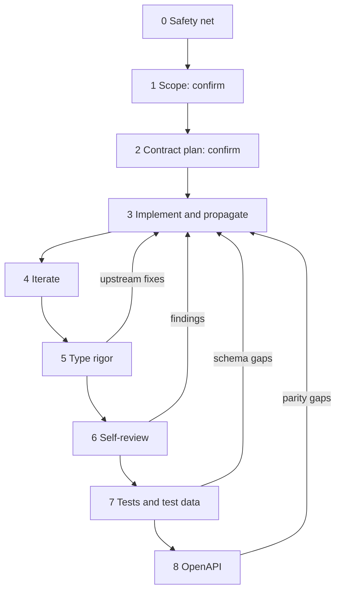

# Zod migration

Move one slice of the estate to Zod-first types, so that `connex-utils-node-v4/src/zod-contracts/<domain>` is the single source of truth. Types flow from there into `connex-dao-node-v4` and the application repos. Behaviour does not change unless a correction is chosen on purpose.

## How to use this skill

Work through the stages in order. **Before starting a stage, read its reference file. Don't read ahead.** Each stage ends with a gate. Don't start the next stage until every gate line is true, and stop where a gate says to ask the user.

At the start, read [references/checklist-process.md](references/checklist-process.md) "Always", and [references/stack-map.md](references/stack-map.md).

| Stage | Read | Gate summary |
| --- | --- | --- |
| 0. Safety net | [00-safety-net.md](references/00-safety-net.md) | Route/API characterization tests are green before any schema edit |
| 1. Scope | [01-scope.md](references/01-scope.md) | **The user confirms the slice** |
| 2. Contract plan | [02-contract-plan.md](references/02-contract-plan.md) | **The user confirms the plan, any non-strict schema, and the home for each constant** |
| 3. Implement and propagate | [03-implement-and-propagate.md](references/03-implement-and-propagate.md) | Contracts are built and copied into `-dao` and every app repo, and `tsconfig` `include` is updated |
| 4. Iterate | [04-iteration.md](references/04-iteration.md) | `type-check` and tests are green in every repo in the slice |
| 5. Type rigor | [05-type-rigor.md](references/05-type-rigor.md) | Every optional/nullable field is justified, no unapproved refinements, every vague type is resolved upstream, agreed locally, or commented |
| 6. Self-review | [06-self-review.md](references/06-self-review.md) | Every line of the schemas checklist is checked, and findings are fixed, asked about, or logged |
| 7. Tests and test data | [07-tests-and-test-data.md](references/07-tests-and-test-data.md) | Fixtures are consolidated, the tests checklist is checked, and the suites are green |
| 8. OpenAPI | [08-openapi.md](references/08-openapi.md) | Baseline taken, drift test green, Zod `createDocument` in place, `ValidateSchema` and `register.js` retired for the slice |

Stages 5 to 8 can loop back to stage 3. A fixture or OpenAPI field that doesn't fit the contract **may** mean the schema is wrong. Decide which side is wrong before changing either. Each loop goes back through propagation and stage 4.

## Rules that hold at every stage

- **Strict by default.** Every Zod schema is strict and applied consistently. **Ask the user before writing anything else**: loose, open `z.object`, an optional kept for compatibility, or mirroring an open legacy setting. If the user approves, the schema gets a code comment saying why and what the end state is, and a row in the slice note's strictness ledger.
- **Contracts first.** Define or change a schema in `zod-contracts` first, then let it flow downstream. Before writing a type in an app repo, check whether a schema already exists to extend. Compose only with `.extend`: no schema `.pick`/`.omit`/`.partial`, and no `Pick`, `Omit` or `Partial` downstream. The one sanctioned `Partial` is a test builder's `overrides` parameter.
- **Optional is a claim.** Every optional field needs evidence. Co-varying optionals are a union. Keep cross-field logic in application code, not in `.refine` or `.superRefine`.
- **Undefined, not null, in application code.** `null` appears only on fields the DB can store as `null`, and is coerced to `undefined` at the parse boundary where one exists. No `?? null`.
- **Look for transforms.** Larger application-side transforms (projecting records up or down, reshaping, formatting) are candidates to move into the contract as `.transform`, with `z.input` and `z.output` types. Suggest them, and record them in the slice note.
- **Watch for constants.** When an enum, status list or magic string is used by more than one repo, recommend a home and ask before moving it. Greenfield constants go in `zod-contracts/<domain>`. Legacy constants go in `connex-utils-node-v4/src/constants` when the risk warrants it.
- **Metadata.** Shared schemas carry no `.meta()`. The exception is `.meta({ deprecated: true })` on deprecated properties.
- **Fix at source.** Fix type errors in the contract, `-dao` or SDK first. A new runtime guard is a last resort, and every one is reported to the user.
- **No commits, pushes, publishes, or version bumps** unless the user asks. Propagate by copying `dist` only. If the user stops or redirects work, stash rather than revert.
- **Run, don't simulate.** Report real command output and before/after error counts, and list the real bugs the typing found.

## Slice note

Every slice keeps one working note, created in stage 1 from [references/slice-note-template.md](references/slice-note-template.md). It records the confirmed scope, preserved and corrected behaviour, the strictness ledger, the optional-fields and vague-types tables from stage 5, constants and transform candidates, guards added, findings from each loop, and what is still legacy. Re-read it at the start of every stage. A later slice that touches the same objects reads the earlier note's ledger first.

## Background

Architecture decisions: `~/Github/planning/zod-fullstack-type-safety/ARCHITECTURE.md`. Legacy-code method: `~/Github/planning/zod-fullstack-type-safety/LEGACY-CODE-SAFETY.md`. Worked example: `~/Github/planning/zod-fullstack-type-safety/SCALE-6317-canonical-contracts.md`. The checklists in `references/` were compiled from past review feedback. The verbatim quotes and sources are in `~/Github/planning/zod-migration-skill/`.

Related skills: `jsdoc` (JSDoc and `checkJs` rules), `typescript-type-safety` (style inside `zod-contracts`), `test-code-quality`.
